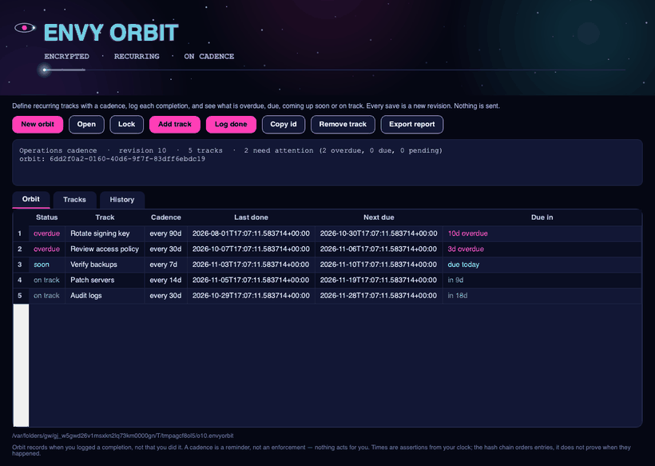
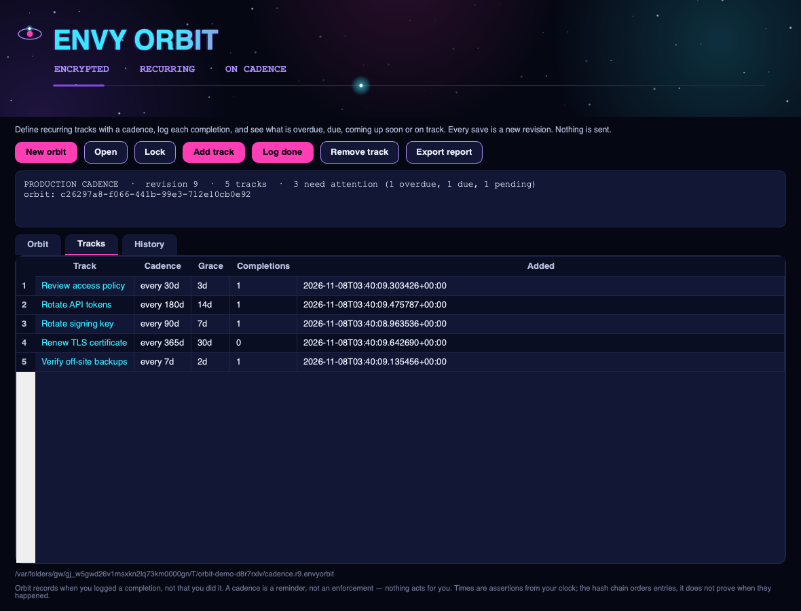

<p align="center">
  
</p>

<p align="center"><b>Define recurring obligations with a cadence, log each completion, and see exactly what is overdue, due, coming up soon or on track — in a real native app window.</b><br />
AES-256-GCM encrypted orbits, a SHA-256 hash-chained completion journal, revision-preserving saves, and plaintext export. From ENVY BLACK VEIL, as a standalone app.</p>

<p align="center">
  <a href="https://github.com/xzchick/envy-orbit/actions/workflows/tests.yml"></a>
</p>
<p align="center">
  
  
  <br />
  
  
  
  
</p>

<p align="center">
  <a href="#install"><b>Install</b></a> ·
  <a href="#works-on">Compatibility</a> ·
  <a href="#using-it">Using it</a> ·
  <a href="#honest-by-design">What it isn't</a> ·
  <a href="#build--test">Build</a>
</p>

<p align="center">
  
</p>

<p align="center"><sub>A real native window — not a browser view. The wordmark pulses, a satellite circles its orbit, and a light travels the accent bar.</sub></p>

<a name="features"></a>




Give Orbit the recurring things you don't want to drop — rotate a key every 90 days, verify a backup weekly, review an access policy monthly — each as a **track** with a **cadence** and an optional **grace** window. When you do one, **log** it: the entry is appended to a **SHA-256 hash-chained journal**, and the track's next due date becomes its last completion plus its cadence. A **status** read folds every track into **overdue**, **due** (past due but inside its grace), **soon**, **on track**, or **never logged** — most urgent first. It is sealed in the same **AES-256-GCM** envelope [ENVY Vault](https://github.com/xzchick/envy-vault) uses.

<p align="center">
  
</p>

The **Tracks** tab manages what recurs, and **History** shows every logged completion with its note. Every save is a new revision — the previous one is never overwritten — and a plaintext HTML or JSON report can be exported whenever you choose. Everything is local.

<a name="works-on"></a>


<p align="center">
  
  
  
</p>



### Requirements

| | 🍎 macOS | 🪟 Windows | 🐧 Linux |
|---|---|---|---|
| **OS version** | macOS 11 Big Sur or newer | Windows 10 or 11 (64-bit) | A current x86_64 or arm64 desktop |
| **Standalone bundle** | Nothing else to install | Nothing else to install | Standard desktop libraries (X11 or Wayland) |
| **From pip** | Python 3.10+ | Python 3.10+ | Python 3.10+ and a desktop session |
| **Dependencies** | `cryptography` + Qt (bundled) | `cryptography` + Qt (bundled) | `cryptography` + Qt (bundled) |
| **Network** | None, ever | None, ever | None, ever |

<a name="install"></a>


A **standalone bundle** that needs no Python, or **pip** if you already have Python 3.10+.

### Standalone bundle (no Python)

Download a bundle from the [latest release](https://github.com/xzchick/envy-orbit/releases/latest):

| File | System | Run it |
|---|---|---|
| `envy-orbit-v0.1.0-macos-arm64.tar.gz` | macOS (Apple Silicon) | `tar -xzf` it, then open `envy-orbit` |
| `envy-orbit-v0.1.0-windows-x86_64.zip` | Windows (64-bit) | Unzip, then run `envy-orbit.exe` |
| `envy-orbit-v0.1.0-linux-x86_64.tar.gz` | Linux (64-bit) | `tar -xzf` it, then run `./envy-orbit` |
| `envy_orbit-0.1.0-py3-none-any.whl` | Any OS with Python 3.10+ | `pip install` the wheel |
| `SHA256SUMS.txt` | — | Verify your download first |

Running `envy-orbit` with no arguments opens the window.

### Homebrew (macOS, Apple Silicon)

```sh
brew install --cask xzchick/envy/envy-orbit
```

These builds aren't notarized, so if macOS blocks it on first run, add `--no-quarantine` to that command. Intel Macs, Linux and Windows: use the standalone bundle above.

### From pip (Python 3.10+)

```sh
git clone https://github.com/xzchick/envy-orbit.git
cd envy-orbit
python3 -m venv .venv
. .venv/bin/activate          # Windows: .venv\Scripts\activate
pip install .
envy-orbit                     # opens the window
```

<a name="using-it"></a>


**In the window**

- **New orbit** → name it, set a passphrase (at least 12 characters).
- **Add track** → name what recurs, set its cadence in days and an optional grace window.
- Select a track, then **Log done** → records a completion now (with an optional note).
- **Orbit** tab → the status board, coloured by state, most urgent first. **Remove track** drops a track but keeps its logged history.
- **Export report** → writes a plaintext HTML or JSON status report.

**In the terminal**

```sh
envy-orbit init ops.envyorbit --title "Ops cadence"
envy-orbit add ops.envyorbit ops.r1.envyorbit --title "Rotate signing key" --every 90 --grace 7
envy-orbit log ops.r1.envyorbit ops.r2.envyorbit --track <id> --note "done"
envy-orbit status ops.r2.envyorbit                 # what's due? (exit 1 if anything needs attention)
envy-orbit export ops.r2.envyorbit report.html --format html
```

`status` exits non-zero when any track is overdue, due or never logged, so it drops straight into a cron job or a login script. Every write is a new file; the orbit is never overwritten.

<a name="honest-by-design"></a>


The orbit and its journal are sealed with **AES-256-GCM** and a key derived from your passphrase with **scrypt**, and the completion log is **hash-chained** so entries cannot be reordered or edited without breaking the chain. What Orbit does **not** do is just as important:

- **It records that you logged it, not that you did it.** A completion is a self-report; Orbit never checks the world to confirm the work happened.
- **A cadence is a reminder, not an enforcement.** Nothing acts for you, blocks anything, or sends an alert — Orbit tells you what is due when you look.
- **Times are assertions.** Completion and log times come from your machine's clock; the hash chain orders entries but does not establish a trusted time.
- **The next due date is only arithmetic.** It is the last logged completion plus the cadence — change the clock or the cadence and it moves.
- **Nothing is sent.** No network, no accounts, no reminders out. Every result is a new local file.

> [!IMPORTANT]
> Keep your passphrase safe. There is no recovery: without it, an encrypted orbit cannot be opened.

<a name="build--test"></a>


```sh
python -m unittest discover -s tests -v          # unit tests (no display needed)
pip install pyinstaller build
python scripts/build_release_bundle.py           # standalone bundle + wheel + sdist + checksums
python scripts/smoke_test_release.py             # launch the built bundle and check it runs
```

CI runs all of this on Ubuntu, Windows and macOS for every push. Regenerate the README artwork with `python scripts/render_readme_art.py`.

## Security

Security policy and private vulnerability reporting: **[SECURITY.md](SECURITY.md)**. What ENVY Orbit does and does not protect against: **[THREAT_MODEL.md](THREAT_MODEL.md)**.

## The ENVY BLACK VEIL suite

ENVY Orbit is one of eleven standalone apps from **ENVY BLACK VEIL** — small native desktop tools that are offline by design: no network, no accounts, no telemetry, everything encrypted at rest.

| App | What it does |
|---|---|
| [ENVY Vault](https://github.com/xzchick/envy-vault) | Local AES-256 file encryption |
| [ENVY Veil](https://github.com/xzchick/envy-veil) | Steganography — hide an encrypted file in an image or audio carrier |
| [ENVY Hypothesis](https://github.com/xzchick/envy-hypothesis) | Analysis of Competing Hypotheses |
| [ENVY Oracle](https://github.com/xzchick/envy-oracle) | Forecast tracking with calibration scoring |
| [ENVY SkyWatch](https://github.com/xzchick/envy-skywatch) | Watchlists with offline content scanning |
| [ENVY Casebook](https://github.com/xzchick/envy-casebook) | Encrypted, revision-preserving case notes |
| [ENVY Cryptography Workbench](https://github.com/xzchick/envy-crypto-workbench) | Classical ciphers, encoding and text analysis |
| **ENVY Orbit** — *you are here* | Recurring-cadence tracking |
| [ENVY Ops Desk](https://github.com/xzchick/envy-ops-desk) | Operations plans with authenticated handoffs |
| [ENVY Evidence Vault](https://github.com/xzchick/envy-evidence-vault) | File intake with a hash-verified custody journal |
| [ENVY Integrity Monitor](https://github.com/xzchick/envy-integrity-monitor) | File-integrity baselines and change detection |

<p align="center"><sub>MIT licensed. Part of ENVY BLACK VEIL, packaged as a standalone app. Offline; no telemetry, no network, no accounts.</sub></p>
